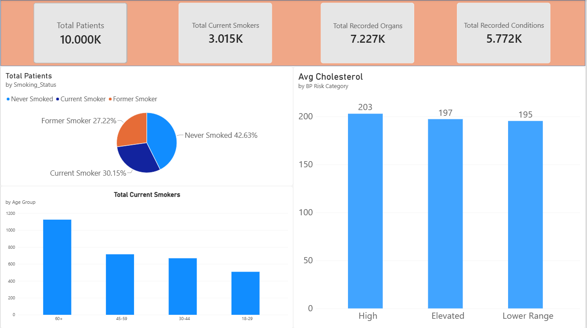
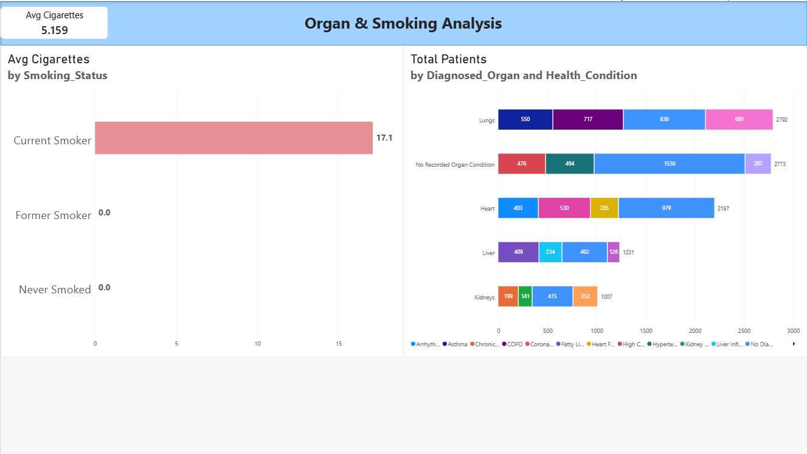
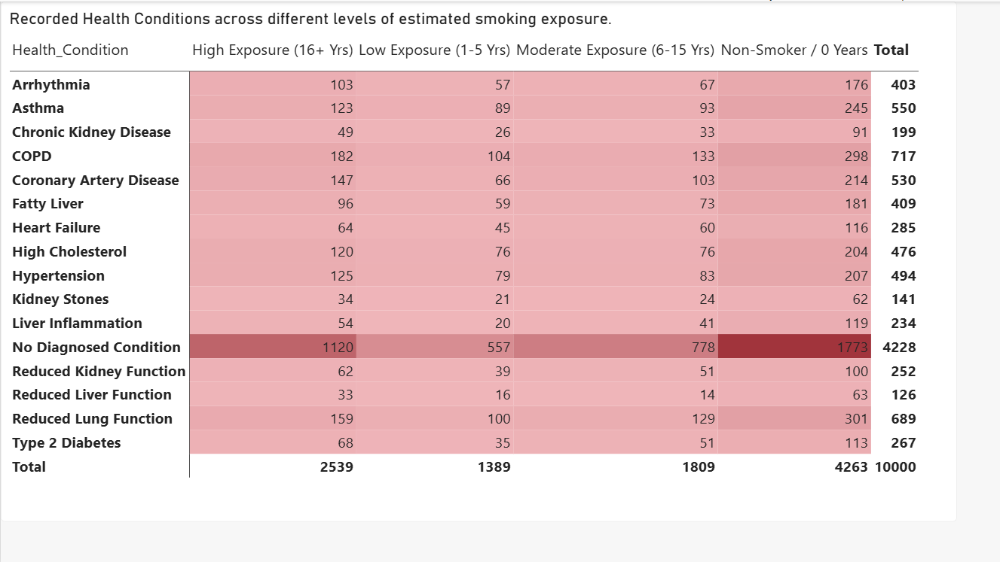
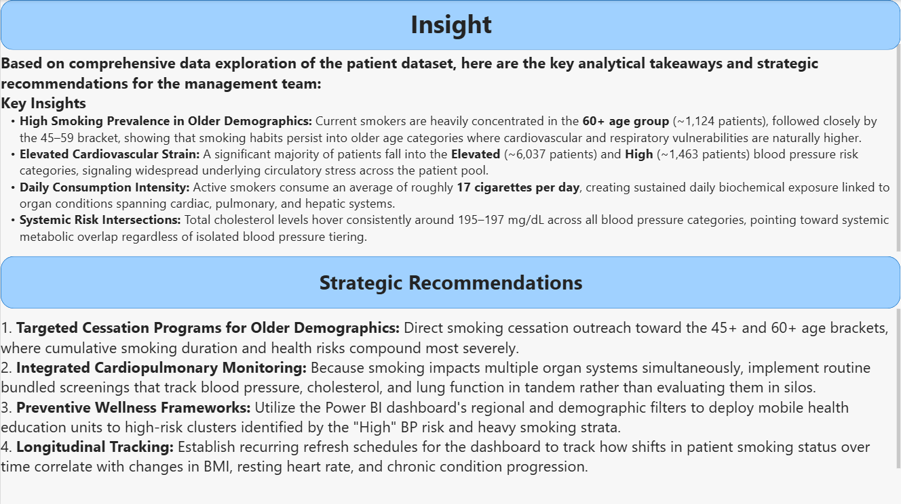

# Smoking and Health Analysis Dashboard (Power BI)

## Project Overview
An interactive **Healthcare Analytics** dashboard built in **Microsoft Power BI** to evaluate patient smoking habits, organ-level health conditions, cholesterol levels, and blood pressure risk across **10,000 patient records**. 

Designed for exploratory analysis and data-driven decision-making, this 4-page report enables healthcare management teams to monitor high-level patient KPIs, evaluate cumulative smoking exposure, and identify high-risk demographic clusters across age groups, genders, and regions. *(Note: Built strictly for educational and exploratory analysis; does not establish clinical diagnoses or causal relationships.)*

---

## Project Objectives

### 1. Executive Health KPIs
* **Total Patients:** Quantify the overall patient cohort size (`10,000`).
* **Total Current Smokers:** Track the active smoking population (`3,015`).
* **Total Recorded Organs:** Measure patients mapped to a specific diagnosed organ category (`7,227`).
* **Total Recorded Conditions:** Count patients with an identified clinical health condition (`5,772`).

### 2. DAX Data Modeling & Feature Engineering
* **Age Group Segmentation:** Build a DAX calculated column categorizing patients into `18-29`, `30-44`, `45-59`, and `60+` cohorts.
* **Blood Pressure (BP) Risk Classification:** Build a DAX calculated column classifying patients into `Lower Range`, `Elevated`, and `High` risk tiers based on systolic and diastolic blood pressure readings.
* **Smoking Exposure Tiering:** Categorize cumulative smoking duration and intensity into `Non-Smoker / 0 Years`, `Low Exposure (1-5 Yrs)`, `Moderate Exposure (6-15 Yrs)`, and `High Exposure (16+ Yrs)`.

### 3. Smoking Patterns & Clinical Indicator Analysis
* **Daily Consumption Intensity:** Evaluate average cigarettes consumed per day across smoking status categories.
* **Organ-Wise Condition Distribution:** Analyze the breakdown of diagnosed health conditions across affected organ systems.
* **Smoking Status Breakdown:** Assess the overall distribution of Current, Former, and Never Smokers.
* **Cholesterol vs. BP Risk:** Compare average total cholesterol levels (`mg/dL`) across blood pressure risk categories.

### 4. Patient Demographics & Cumulative Exposure Profiling
* **Smoker Concentration by Age:** Analyze the distribution of current smokers across age brackets.
* **Health Conditions by Smoking Exposure:** Evaluate recorded health condition prevalence across different levels of estimated cumulative smoking exposure.

---

## Key Analytical Insights
* **High Smoking Prevalence in Older Demographics:** Current smokers are heavily concentrated in the **60+ age group (1,124 patients)**, followed closely by the **45–59** bracket, showing persistent smoking habits among demographics with higher baseline cardiopulmonary vulnerability.
* **Widespread Cardiovascular Strain:** Over **75% of the patient pool** falls into **Elevated (6,037 patients)** or **High (1,463 patients)** blood pressure risk categories.
* **Sustained Daily Cigarette Exposure:** Active smokers consume an average of **17.1 cigarettes per day**, driving multi-organ health risks across the **Lungs (2,792)**, **Heart (2,197)**, **Liver (1,231)**, and **Kidneys (1,007)**.
* **Prevalent Health Conditions:** Beyond patients with no diagnosed condition (`4,228`), the most frequently recorded conditions include **COPD (717)**, **Reduced Lung Function (689)**, **Asthma (550)**, and **Coronary Artery Disease (530)**.

---

## Dashboard Pages & Visual Breakdown

### 1. Executive Overview
* **Top KPI Cards:** Tracks `Total Patients` (10,000), `Total Current Smokers` (3,015), `Total Recorded Organs` (7,227), and `Total Recorded Conditions` (5,772).
* **Visuals:**
  * **Smoking Status Distribution (Pie Chart):** Breaks down Never Smoked (42.63%), Current Smoker (30.15%), and Former Smoker (27.22%).
  * **Current Smokers by Age Group (Clustered Column Chart):** Compares active smoker counts across `60+`, `45-59`, `30-44`, and `18-29`.
  * **Average Cholesterol by BP Risk Category (Clustered Column Chart):** Evaluates mean total cholesterol (`mg/dL`) across `High` (203), `Elevated` (197), and `Lower Range` (195) blood pressure tiers.



### 2. Organ & Smoking Analysis
* **KPI Highlight:** Displays overall `Avg Cigarettes` consumed per day (`5.16`) alongside a clean top banner.
* **Visuals:**
  * **Average Cigarettes per Day by Smoking Status (Bar Chart):** Contrasts daily consumption intensity across Current Smokers (`17.1`), Former Smokers (`0.0`), and Never Smokers (`0.0`).
  * **Organ-Wise Health Condition Distribution (Stacked Bar Chart):** Maps specific diagnoses (COPD, Coronary Artery Disease, Fatty Liver, CKD, etc.) across affected organs.



### 3. Exposure Matrix
* **Visual:** A conditionally formatted **Matrix Heatmap** cross-tabulating `Health_Condition` against `Smoking Exposure Tier` to highlight where chronic conditions concentrate as cumulative smoking exposure increases.



### 4. Key Insights
* **Executive Summary & Action Plan:** Synthesizes core analytical takeaways alongside four strategic recommendations: targeted cessation outreach for the 45+ and 60+ cohorts, integrated cardiopulmonary screenings, regional preventive wellness frameworks, and longitudinal patient tracking.



---

## Repository Structure
```text
├── Smoking_Health_Analysis_by_Anuj_3.pbix   # Interactive Power BI Desktop report
├── Smoking_Health_Analysis.csv              # Source patient dataset (10,000 records)
├── screenshots/                             # Exported PNG images of all 4 report pages
│   ├── executive_overview.png
│   ├── organ_smoking_analysis.png
│   ├── exposure_matrix.png
│   └── key_insights.png
└── README.md                                # Project documentation & objectives
